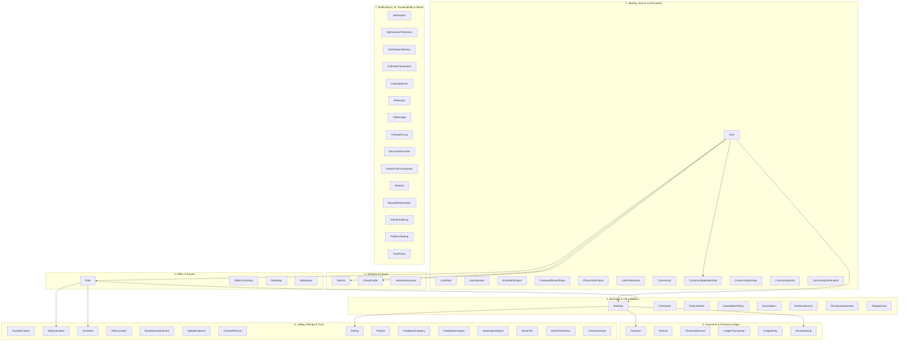

# Rydora Database Architecture & Data Specification

This document provides the definitive, comprehensive architectural specification for the Rydora modular monolith database schema implemented in PostgreSQL via Prisma ORM.

---

## 1. Executive Summary & Design Principles

- **Engine & Dialect:** PostgreSQL 15+ via Prisma ORM (v6).
- **Primary Keys:** Cryptographically secure UUIDs (`@id @default(uuid()) @db.Uuid`) across all models, preventing enumeration attacks and supporting distributed client-side UUID generation.
- **Relational Integrity:** Explicit foreign keys with strictly audited deletion behaviors (`Cascade`, `Restrict`, `SetNull`) to protect historical financial transactions, safety audits, and booking records.
- **Auditability & Traceability:** Timestamps (`createdAt`, `updatedAt`) across all mutable entities, soft deletes (`deletedAt`) for identity preservation, and immutable ledger/audit logs.
- **Financial Rigor:** Fixed-precision decimal monetary modeling (`Decimal(10, 2)`), double-entry ledger bookkeeping, explicit separation of payment attempts from internal balances, and strict `isSimulated` labeling.
- **Decoupled Intelligence:** AI operations and classification models are advisory/assistive only. No automated penalties, account suspensions, or payments are triggered directly by AI sentiment or third-party inference.

---

## 2. Domain Modules & Model Directory

The schema encompasses **48 models** organized across **7 core functional domains**:



---

## 3. Module Details & Model Specifications

### Module 1: Identity, Authentication & Communities
- **`User`**: Primary user identity holding profile information, credentials, verified contact timestamps, and soft deletion.
- **`UserRole`**: Role-based access control (`RIDER`, `DRIVER`, `ADMIN`) with composite unique constraint `[userId, role]`.
- **`UserSession`**: Active refresh tokens, client device info, IP addresses, and revocation tracking.
- **`EmailVerification`**: Hashed tokens for validating email addresses.
- **`PasswordResetToken`**: Single-use hashed tokens with expiration for password recovery.
- **`PhoneVerification`**: Hashed OTP tokens, phone verification timestamps, and brute-force attempt counters.
- **`UserPreference`**: 1-to-1 personalization settings (UI theme, language, accessibility JSON).
- **`Community`**: Verified institutional and regional clusters (University, Office, Neighborhood, Private).
- **`CommunityMembership`**: User-community links tracking roles (`MEMBER`, `MODERATOR`, `ADMIN`) and verification state (`PENDING`, `VERIFIED`, `REVOKED`).
- **`CommunityDomain`**: Whitelisted institutional email domains (e.g., `@university.edu`, `@company.com`).
- **`CommunityInvite`**: Hashed single/multi-use invitation codes with optional email domain restrictions.
- **`CommunityVerification`**: Historical verification log for student/employee credentials with reviewer audit trails.

### Module 2: Vehicles and Driver Eligibility
- **`Vehicle`**: Vehicles registered by users with vehicle type, make, model, color, seat capacity, verification status, and active toggle.
- **`DriverProfile`**: Independent driver qualification entity decoupling vehicle ownership from legal driving entitlement (license verification, background clearance, eligibility status).
- **`VehicleDocument`**: Secure file references (RC, insurance, pollution fitness, commercial permits) with document expiry dates and reviewer tracking.

### Module 3: Rides and Routes
- **`Ride`**: Scheduled shared ride published by a verified driver with origin/destination lat-lng coordinates, addresses, place IDs, departure timestamps, seats remaining, and base pricing.
- **`RideCommunity`**: Junction model enabling a single ride to be discoverable across multiple verified communities (`@@unique([rideId, communityId])`).
- **`RideStop`**: Sequenced intermediate waypoints, pickup spots, and drop-off stations with strict order uniqueness (`@@unique([rideId, sequence])`).
- **`RideRoute`**: Practical navigation entity storing encoded polyline geometry, distance in meters, duration in seconds, provider tags, and route metadata without requiring complex PostGIS dependencies.

### Module 4: Bookings, Fare Quotes and Cancellations
- **`Booking`**: Rider seat reservation holding immutable pickup/drop-off coordinates, seat count, confirmed total fare snapshot, and confirmation timestamp.
- **`FareQuote`**: Pre-booking price quotation with time-to-live expiration and calculation payload.
- **`FareLineItem`**: Itemized pricing breakdown (base fare, distance, time, platform fee, surge, community discount).
- **`CancellationPolicy`**: Platform cancellation rules defining penalty formulas and free cancellation time windows.
- **`Cancellation`**: Audit record of cancelled trips recording responsible party (`RIDER`, `DRIVER`, `PLATFORM`), reason, timestamp, and calculated penalty.
- **`NoShowRecord`**: Independent record of passenger/driver abandonment tracking waiting times and verification status.
- **`PenaltyAssessment`**: Policy-driven fee assessment decoupled from financial settlement.
- **`DisputeCase`**: Formal dispute ticketing workflow between rider and driver with reviewer audit trails.

### Module 5: Payments, Ledger and Driver Earnings
- **`Payment`**: External payment transaction attempts with gateway references, currency, status, idempotency keys, and explicit `isSimulated` indicators.
- **`Refund`**: Refund operations tied to original payment attempts with gateway reference tracking.
- **`FinancialAccount`**: Internal balance and wallet accounts (`USER_WALLET`, `DRIVER_ESCROW`, `PLATFORM_TREASURY`) maintaining zero-sum integrity.
- **`LedgerTransaction`**: Grouped journal transactions categorizing financial events with idempotency keys.
- **`LedgerEntry`**: Atomic debit and credit journal lines enforcing double-entry bookkeeping and historical balance integrity.
- **`DriverEarning`**: Granular driver payout calculation per ride/booking tracking gross earnings, platform commission cuts, deductions, and net payouts.

### Module 6: Safety, Ratings and Trust
- **`TrustedContact`**: Up to three emergency contacts per user with automatic notification preferences.
- **`SafetyIncident`**: Incident reporting ticketing system with severity categories, reporter/reported user linkage, and resolution history.
- **`SOSAlert`**: High-priority panic button activation tied directly to an active ride with GPS coordinates.
- **`RideLocation`**: Real-time GPS location breadcrumbs captured during active rides (designed for automated pruning retention policies).
- **`RouteDeviationEvent`**: Automated geofencing deviations detecting unplanned route departures.
- **`SafetyEvidence`**: Restricted file attachments (photos, audio snippets) for safety incident resolution.
- **`ConsentRecord`**: Explicit, granular user privacy consents (telemetry tracking, audio recording, emergency contact sharing).
- **`Rating`**: Bidirectional 1-to-5 star ratings between rider and driver per booking (`@@unique([bookingId, raterId])`).
- **`Review`**: Qualitative review text and headlines linked 1-to-1 with a rating.
- **`FeedbackCategory`**: Categorical feedback tags (e.g., "Punctual", "Clean Vehicle", "Safe Driving").
- **`FeedbackAnalysis`**: Decoupled AI sentiment analysis scores and detected issues (informational only; cannot autonomously penalize users).
- **`ModerationReport`**: Administrative abuse and moderation queue.
- **`DriverTier`**: Driver career tiers with rating thresholds and fee discounts.
- **`DriverTierHistory`**: Non-repudiable audit log of driver tier promotions and demotions.
- **`DriverIncentive`**: Gamified driver challenges, quest milestones, and performance bonuses.

### Module 7: Notifications, Calendar, AI, Sustainability and Admin
- **`Notification`**: In-app notifications with polymorphic entity references (`RIDE`, `BOOKING`, `PAYMENT`, etc.).
- **`NotificationPreference`**: 1-to-1 channel preferences (Email, SMS, Push) and topic subscriptions.
- **`NotificationDelivery`**: Multi-channel delivery telemetry logging gateway responses and failure diagnostics.
- **`CalendarConnection`**: Third-party calendar integrations (Google, Outlook, Apple) with encrypted token storage.
- **`CalendarEvent`**: Synced commute events providing read-only ride suggestions (strictly non-authoritative).
- **`AISession`**: Multi-turn conversational AI sessions supporting replaceable providers (Gemini, OpenAI, Anthropic).
- **`AIMessage`**: Individual turns within an AI session with token metrics and role tracking.
- **`AIAnalysisLog`**: Background AI operation audit log recording latency, model used, and estimated execution costs.
- **`EmissionEstimate`**: Carbon offset and emissions savings calculations per ride/booking according to `DEFRA_2024` standards.
- **`GreenPointTransaction`**: Green rewards point ledger for eco-friendly shared commutes.
- **`Reward`**: Catalog of redeemable rewards, coupons, and community perks.
- **`RewardRedemption`**: Redemptions tracking unique claim codes and fulfillment states.
- **`AdminAuditLog`**: Tamper-evident log of staff actions, security policy overrides, and account suspensions.
- **`PlatformSetting`**: System configuration store for dynamic platform constants, timeouts, and commission tiers.
- **`FarePolicy`**: Regional fare calculation policies including base rates, per-km/per-minute rates, and surge limits.

---

## 4. Enumeration Catalog (39 Enums)

| Module | Enum Name | Values |
| :--- | :--- | :--- |
| **Identity** | `AccountStatus` | `ACTIVE`, `SUSPENDED`, `DEACTIVATED` |
| | `RoleType` | `RIDER`, `DRIVER`, `ADMIN` |
| | `ThemeType` | `LIGHT`, `DARK`, `SYSTEM` |
| | `CommunityType` | `UNIVERSITY`, `OFFICE`, `NEIGHBORHOOD`, `PRIVATE` |
| | `CommunityStatus` | `ACTIVE`, `INACTIVE`, `SUSPENDED` |
| | `MembershipStatus` | `PENDING`, `ACTIVE`, `REJECTED`, `REVOKED` |
| | `CommunityRole` | `MEMBER`, `MODERATOR`, `ADMIN` |
| | `VerificationStatus` | `NOT_STARTED`, `PENDING`, `VERIFIED`, `REJECTED`, `NOT_REQUIRED` |
| | `VerificationMethod` | `EMAIL_DOMAIN`, `INVITE_CODE`, `MANUAL` |
| | `VerificationAttemptStatus` | `PENDING`, `VERIFIED`, `REJECTED`, `EXPIRED` |
| **Fleet** | `VehicleType` | `SEDAN`, `HATCHBACK`, `SUV`, `MOTORCYCLE`, `VAN`, `OTHER` |
| | `DriverEligibilityStatus` | `ELIGIBLE`, `INELIGIBLE`, `PENDING_REVIEW`, `SUSPENDED` |
| | `VehicleDocumentType` | `REGISTRATION_CERTIFICATE`, `INSURANCE`, `POLLUTION_FITNESS`, `COMMERCIAL_PERMIT`, `OTHER` |
| | `DocumentVerificationStatus`| `PENDING`, `VERIFIED`, `REJECTED`, `EXPIRED` |
| **Routing** | `RideStatus` | `SCHEDULED`, `ACTIVE`, `COMPLETED`, `CANCELLED` |
| | `StopType` | `PICKUP`, `DROPOFF`, `WAYPOINT` |
| **Bookings**| `BookingStatus` | `PENDING`, `CONFIRMED`, `COMPLETED`, `CANCELLED`, `NO_SHOW`, `EXPIRED` |
| | `FareQuoteStatus` | `ACTIVE`, `ACCEPTED`, `EXPIRED`, `REJECTED` |
| | `FareLineItemType` | `BASE_FARE`, `DISTANCE_FARE`, `TIME_FARE`, `PLATFORM_FEE`, `COMMUNITY_DISCOUNT`, `SURGE`, `TAX`, `OTHER` |
| | `ResponsibleParty` | `RIDER`, `DRIVER`, `PLATFORM` |
| | `NoShowStatus` | `PENDING`, `VERIFIED`, `REJECTED` |
| | `PenaltyAssessmentStatus` | `PENDING`, `WAIVED`, `APPLIED`, `DISPUTED` |
| | `DisputeStatus` | `OPEN`, `UNDER_REVIEW`, `RESOLVED`, `REJECTED` |
| **Finance** | `PaymentMethod` | `CARD`, `UPI`, `NET_BANKING`, `WALLET`, `SIMULATED` |
| | `PaymentStatus` | `PENDING`, `PROCESSING`, `COMPLETED`, `FAILED`, `REFUNDED`, `PARTIALLY_REFUNDED` |
| | `RefundStatus` | `PENDING`, `PROCESSING`, `SUCCEEDED`, `FAILED` |
| | `FinancialAccountType` | `USER_WALLET`, `DRIVER_ESCROW`, `PLATFORM_TREASURY` |
| | `FinancialAccountStatus` | `ACTIVE`, `FROZEN`, `CLOSED` |
| | `LedgerTransactionType` | `RIDE_PAYMENT`, `DRIVER_PAYOUT`, `PLATFORM_COMMISSION`, `REFUND`, `PENALTY`, `INCENTIVE` |
| | `LedgerEntryType` | `DEBIT`, `CREDIT` |
| | `DriverEarningStatus` | `PENDING`, `AVAILABLE`, `PAID_OUT`, `WITHHELD` |
| **Trust** | `IncidentSeverity` | `LOW`, `MEDIUM`, `HIGH`, `CRITICAL` |
| | `IncidentStatus` | `REPORTED`, `INVESTIGATING`, `RESOLVED`, `DISMISSED` |
| | `IncidentCategory` | `HARASSMENT`, `RECKLESS_DRIVING`, `ROUTE_DEVIATION`, `VEHICLE_CONDITION`, `PAYMENT_DISPUTE`, `OTHER` |
| | `SOSAlertStatus` | `TRIGGERED`, `ACKNOWLEDGED`, `RESOLVED`, `FALSE_ALARM` |
| | `DeviationStatus` | `DETECTED`, `ACKNOWLEDGED`, `RESOLVED`, `FALSE_POSITIVE` |
| | `ConsentType` | `LOCATION_TRACKING`, `EMERGENCY_CONTACT_SHARING`, `AUDIO_RECORDING`, `MARKETING_COMMUNICATION` |
| | `SentimentLabel` | `POSITIVE`, `NEUTRAL`, `NEGATIVE` |
| | `ModerationTargetType` | `USER`, `REVIEW`, `COMMUNITY`, `CHAT` |
| | `ModerationStatus` | `PENDING`, `INVESTIGATING`, `RESOLVED`, `DISMISSED` |
| | `IncentiveStatus` | `ACTIVE`, `COMPLETED`, `EXPIRED`, `CANCELLED` |
| **Operations** | `NotificationType` | `RIDE_UPDATE`, `BOOKING_CONFIRMATION`, `SAFETY_ALERT`, `PAYMENT_RECEIPT`, `COMMUNITY_ANNOUNCEMENT`, `REWARD_EARNED`, `SYSTEM` |
| | `NotificationChannel` | `IN_APP`, `EMAIL`, `SMS`, `PUSH` |
| | `DeliveryStatus` | `PENDING`, `SENT`, `DELIVERED`, `FAILED` |
| | `CalendarProvider` | `GOOGLE`, `OUTLOOK`, `APPLE` |
| | `AISessionType` | `RIDE_ASSISTANT`, `SUPPORT_CHATBOT`, `ROUTE_OPTIMIZER` |
| | `AIMessageRole` | `SYSTEM`, `USER`, `ASSISTANT` |
| | `GreenPointType` | `RIDE_SHARED`, `ZERO_EMISSION_BONUS`, `COMMUNITY_BONUS`, `REWARD_REDEMPTION`, `ADJUSTMENT` |
| | `RedemptionStatus` | `PENDING`, `FULFILLED`, `CANCELLED`, `EXPIRED` |

---

## 5. Relational Integrity & Referential Actions

To safeguard mission-critical data, deletion cascades are strictly controlled:

1. **`onDelete: Restrict` (Preserve Historical Records)**:
   - Users cannot be hard-deleted if they have associated rides driven, rider bookings, ratings given/received, payments, or reported safety incidents.
   - Vehicles cannot be deleted if historical completed rides reference them.
   - Bookings cannot be deleted if associated cancellations, no-show reports, penalty assessments, disputes, payments, or ratings exist.
2. **`onDelete: SetNull` (Preserve Record when Parent is Deactivated)**:
   - Staff/Moderator reviewer references (`reviewerId`, `resolvedById`, `moderatorId`) are set to `null` if the staff account is removed, preserving the integrity of the audit record.
   - Optional foreign keys like `fareQuoteId` on `Booking` or `suggestedRideId` on `CalendarEvent` are decoupled cleanly.
3. **`onDelete: Cascade` (Clean Dependent Child State)**:
   - User credentials, sessions, preferences, and notifications cascade when a user account is purged.
   - Ride intermediate stops, route polylines, and community links cascade with the parent `Ride`.
   - Double-entry `LedgerEntry` items cascade with the parent `LedgerTransaction`.

---

## 6. Key Constraints & Indexing Strategy

- **Uniqueness Guarantees**:
  - `User(email)`: Case-insensitive unique platform login.
  - `UserRole(userId, role)`: Prevents assigning the same role to a user twice.
  - `CommunityMembership(userId, communityId)`: Restricts users to one membership record per community.
  - `CommunityDomain(communityId, domain)`: Prevents duplicate domain registrations.
  - `Vehicle(registrationNumber)`: Global plate registration uniqueness across the platform.
  - `RideCommunity(rideId, communityId)`: Prevents duplicate community linkages for a ride.
  - `RideStop(rideId, sequence)`: Enforces reliable, non-conflicting waypoint ordering.
  - `Rating(bookingId, raterId)`: Restricts riders and drivers to exactly one rating submission per booking.
  - `Payment(idempotencyKey)` & `LedgerTransaction(idempotencyKey)`: Prevents duplicate billing and double payouts.
- **Operational Indexes**:
  - `Ride(departureTime, rideStatus)`: High-performance range scanning for ride matching.
  - `RideLocation(rideId, recordedAt)`: Rapid time-series retrieval of GPS tracks.
  - `Notification(userId, isRead)`: Fast unread notification badge lookups.
  - `DisputeCase(status)` & `SafetyIncident(status)`: Queue filtering for operational triage.

---

## 7. Sensitive Data & Privacy Safeguards

- **Password & Token Hashes**: Passwords, refresh tokens, email verification tokens, and OTPs are stored only as salted hashes (`passwordHash`, `tokenHash`, `otpHash`, `codeHash`). Cleartext secrets are never stored.
- **Document & Media Storage**: Identity documents, vehicle RCs, and incident evidence photos are stored in secure S3/cloud storage; only signed/secure URLs and storage keys (`fileUrl`) are stored in PostgreSQL.
- **Location Retention**: GPS breadcrumbs in `RideLocation` are transient. In production, a scheduled cron task or database TTL policy should truncate locations older than 30 days unless tied to an active `SafetyIncident` or `DisputeCase`.
- **Calendar Suggestions**: Calendar integrations are strictly read-only suggestion sources. Calendar event suggestions can never automatically commit financial charges or confirm bookings.

---

## 8. Migration Guidance for Anindya (Repository & Database Owner)

> [!IMPORTANT]
> **Owner Protocol:** Anindya owns the migration and database push pipeline. The application agent has strictly formatted, validated, and generated the client without executing any live database migrations.

### Step-by-Step Migration Execution Procedure

When applying these changes to Supabase / PostgreSQL:

1. **Verify Environment**:
   Ensure `DATABASE_URL` in `backend/.env` points to your development Supabase connection string:
   ```bash
   cd Ap-capstone/backend
   ```
2. **Review Schema Validity**:
   ```bash
   npx prisma format
   npx prisma validate
   ```
3. **Generate Initial Migration**:
   Create a clean, descriptive migration without applying it destructively:
   ```bash
   npx prisma migrate dev --name init_rydora_modular_schema --create-only
   ```
4. **Inspect Generated SQL**:
   Review the generated SQL file in `backend/prisma/migrations/*_init_rydora_modular_schema/migration.sql`.
   Verify:
   - UUID extensions (`CREATE EXTENSION IF NOT EXISTS "uuid-ossp";` or `gen_random_uuid()`).
   - Indexes and unique constraints.
   - Enum creation blocks.
5. **Apply Migration to Development Database**:
   ```bash
   npx prisma migrate dev
   ```
6. **Generate Production Prisma Client**:
   ```bash
   npm run prisma:generate # or npx prisma generate
   ```

---

## 9. Comprehensive Schema Checklist

- [x] All 48 models designed with UUID primary keys.
- [x] All 39 enums populated with explicit values.
- [x] Bidirectional inverse relations fully mapped on every model.
- [x] Explicit relation names applied for ambiguous multi-relation entities (`DriverRides`, `RiderBookings`, `RatingsGiven`, `RatingsReceived`, `ReportedIncidents`, etc.).
- [x] Monetary values modeled with `Decimal(10, 2)` instead of floating points.
- [x] Double-entry ledger architecture implemented with idempotency keys.
- [x] Simulated payment flags (`isSimulated`) applied to separate mock and live transactions.
- [x] Safety and incident audit trails decoupled from automated punishment logic.
- [x] Route stops strictly ordered with sequence uniqueness.
- [x] Full non-destructive Prisma validation executed successfully (`prisma validate` passed with 0 errors).
- [x] Prisma Client v6.19.3 generated cleanly.

