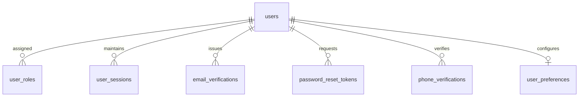
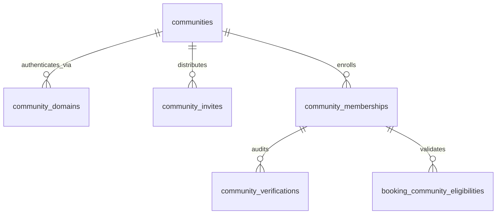
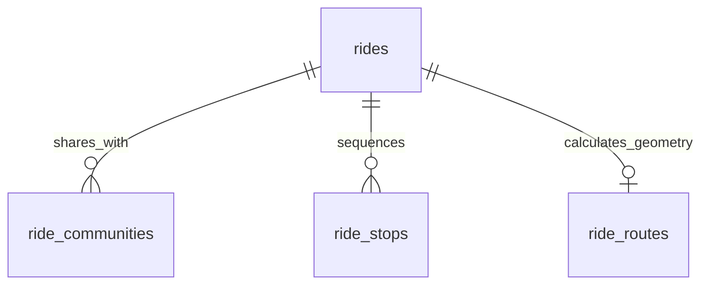
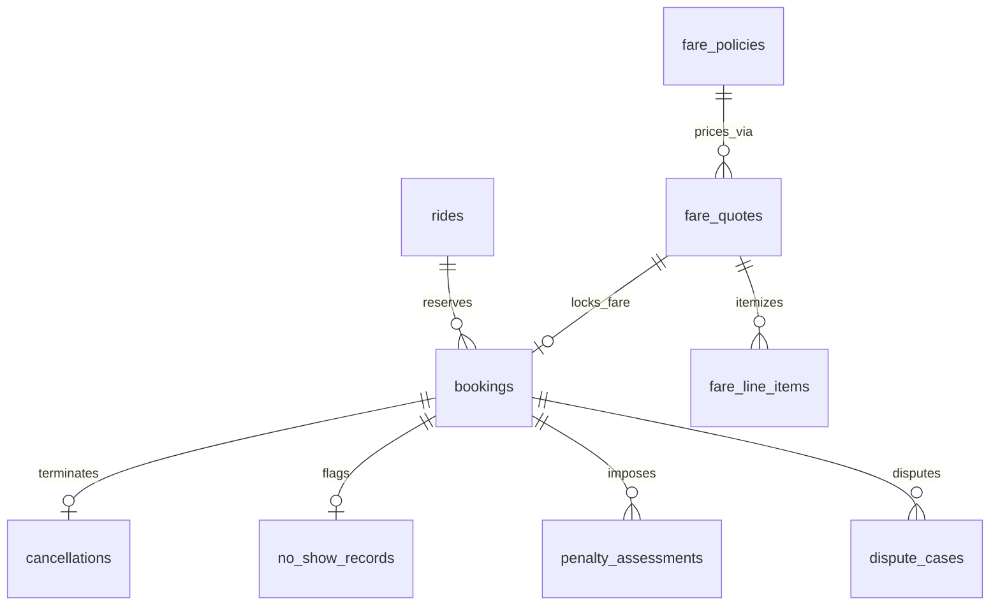
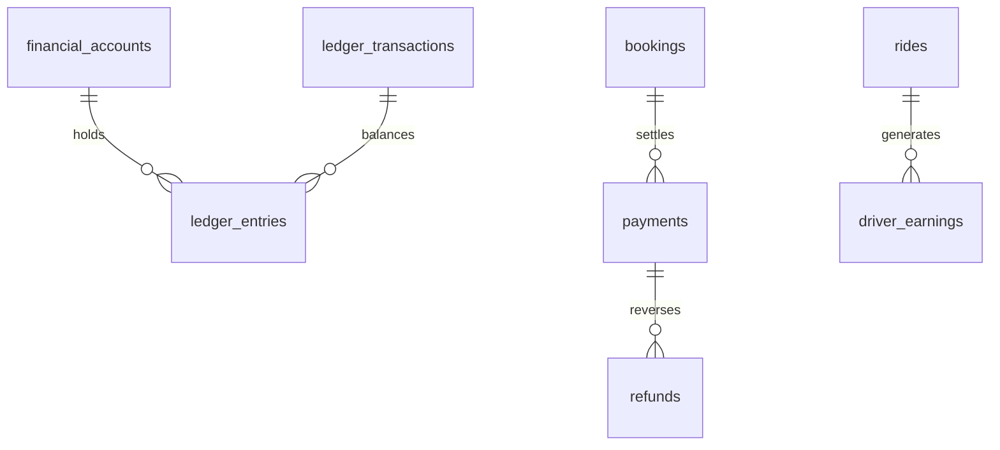

# Rydora Ride-Sharing & Carpooling Platform: Relational Database Normalization & Dependency Specification

**Document Version:** 1.0.0  
**Deliverable:** Database Normalization Specification (`normalization.md`)  
**Project:** Rydora — Community-First Ride-Sharing & Carpooling Ecosystem  
**Target Engine:** PostgreSQL 15+ / Prisma ORM v7  
**Schema Definition:** `backend/prisma/schema.prisma` (64 Relational Models, 49 Domain Enums)  
**Deliverable Context:** AP Project Checkpoint 2 (CP2)  
**Academic Cohort:** Team T0145 · Section A  
**Authors & Engineering Contributors:**
- Badal Khandelwal (Lead Backend & Database Architect)
- Anindya Sarkar (Database Administrator & Auth Specialist)
- Anshika Srivastava (Data Modeler & Systems Analyst)
- Atharv (Safety, Real-Time & Communications Engineer)

---

## Table of Contents

1. [Executive Summary & Normalization Objectives](#1-executive-summary--normalization-objectives)
2. [Theoretical Foundations of Relational Normalization](#2-theoretical-foundations-of-relational-normalization)
   - [2.1 Functional Dependencies (FDs)](#21-functional-dependencies-fds)
   - [2.2 Normal Forms Criteria (1NF through BCNF and 4NF)](#22-normal-forms-criteria-1nf-through-bcnf-and-4nf)
   - [2.3 Modification Anomalies Addressed](#23-modification-anomalies-addressed)
3. [Domain-by-Domain Normalization & Functional Dependency Analysis](#3-domain-by-domain-normalization--functional-dependency-analysis)
   - [Module 1: Identity, Authentication & Preferences](#module-1-identity-authentication--preferences-7-entities)
   - [Module 2: Communities, Domain Verification & Membership](#module-2-communities-domain-verification--membership-6-entities)
   - [Module 3: Fleet & Driver Management](#module-3-fleet--driver-management-3-entities)
   - [Module 4: Rides, Routes, Stops & Waypoints](#module-4-rides-routes-stops--waypoints-4-entities)
   - [Module 5: Bookings, Dynamic Quotes & Cancellations](#module-5-bookings-dynamic-quotes--cancellations-8-entities)
   - [Module 6: Financial Ledger, Escrow & Earnings](#module-6-financial-ledger-escrow--earnings-6-entities)
   - [Module 7: Safety, Real-Time Telemetry, SOS & Evidence](#module-7-safety-real-time-telemetry-sos--evidence-7-entities)
   - [Module 8: Ratings, Reviews, AI Feedback & Driver Tiers](#module-8-ratings-reviews-ai-feedback--driver-tiers-8-entities)
   - [Module 9: Multi-Channel Notifications & Preferences](#module-9-multi-channel-notifications--preferences-3-entities)
   - [Module 10: External Calendar Integrations](#module-10-external-calendar-integrations-2-entities)
   - [Module 11: Artificial Intelligence Services](#module-11-artificial-intelligence-services-3-entities)
   - [Module 12: Ecological Sustainability & Green Rewards](#module-12-ecological-sustainability--green-rewards-4-entities)
   - [Module 13: Platform Administration & Dynamic Policies](#module-13-platform-administration--dynamic-policies-3-entities)
4. [Lossless Join Decomposition & Dependency Preservation Proofs](#4-lossless-join-decomposition--dependency-preservation-proofs)
5. [Multi-Valued Dependency (4NF) & Join Dependency (5NF) Analysis](#5-multi-valued-dependency-4nf--join-dependency-5nf-analysis)
6. [Controlled Semi-Structured Attributes (JSON Justification)](#6-controlled-semi-structured-attributes-json-justification)
7. [Comprehensive Entity Relationship & Referential Cardinality Matrix](#7-comprehensive-entity-relationship--referential-cardinality-matrix)
8. [Conclusion & Production Readiness Verification](#8-conclusion--production-readiness-verification)

---

## 1. Executive Summary & Normalization Objectives

The **Rydora** database architecture is designed as an enterprise-grade, highly normalized relational foundation supporting a community-driven ride-sharing platform. Built upon PostgreSQL 15+ and managed via Prisma ORM, the physical schema consists of:
- **64 Distinct Relational Tables**
- **49 Strongly-Typed Domain Enums**
- **100% Cryptographic UUID Primary Keys** (`UUIDv4`) to eliminate enumeration attacks and partition bottlenecks.

The primary objective of this normalization specification is to formally demonstrate that the Rydora schema:
1. **Eliminates Redundancy:** Prevents duplicate facts from being stored across multiple rows or tables.
2. **Prevents Update, Insertion, and Deletion Anomalies:** Guarantees that updating a user attribute, deleting a vehicle, or cancelling a booking does not corrupt surrounding relational integrity or orphan historical audit logs.
3. **Achieves Boyce-Codd Normal Form (BCNF) / Third Normal Form (3NF):** Verifies that every determinant attribute is a candidate key for all functional dependencies.
4. **Guarantees Lossless Join Decomposition:** Proves that decomposes of complex domain entities (e.g., decomposing a raw Ride into `Ride`, `RideRoute`, `RideStop`, and `RideCommunity`) retain mathematical equivalence and can be reconstituted without spurious tuples.
5. **Maintains Financial & Safety Immutability:** Enforces strict separation between mutable operational states and immutable historical snapshots (e.g., `BookingCommunityEligibility`, `FareQuote`, `LedgerEntry`, and `SafetyEvidence`).

---

## 2. Theoretical Foundations of Relational Normalization

### 2.1 Functional Dependencies (FDs)
Given a relational schema $R$ and subsets of attributes $X, Y \subseteq R$, a **Functional Dependency** denoted as:
$$X \rightarrow Y$$
holds over $R$ if and only if for any two valid tuples $t_1, t_2 \in R$:
$$t_1[X] = t_2[X] \implies t_1[Y] = t_2[Y]$$
In Rydora, $X$ constitutes a **Superkey** if $X \rightarrow R$. If no proper subset $X' \subset X$ functionally determines $R$, then $X$ is a **Candidate Key** ($CK$). The primary key ($PK$) is chosen as a surrogate UUID from the set of candidate keys.

### 2.2 Normal Forms Criteria (1NF through BCNF and 4NF)

#### First Normal Form (1NF)
A relation $R$ is in **1NF** if and only if:
1. All underlying attribute domains contain purely atomic (indivisible) values.
2. There are no repeating groups or composite multivalued arrays stored in scalar columns.
3. Each record is uniquely identifiable by a primary key.

*Rydora Compliance:* All scalar columns adhere to strict SQL primitive types (`VARCHAR`, `INTEGER`, `DECIMAL(10,2)`, `BOOLEAN`, `TIMESTAMP`, `UUID`). No comma-separated strings or unstructured arrays are used for core relationships.

#### Second Normal Form (2NF)
A relation $R$ is in **2NF** if and only if:
1. $R$ is in 1NF.
2. Every non-prime attribute $A \in R$ is **fully functionally dependent** on the primary key (i.e., no non-prime attribute is functionally dependent on a proper subset of any candidate key).

*Rydora Compliance:* Candidate keys that are composite (such as `(userId, role)` in `UserRole`, `(userId, communityId)` in `CommunityMembership`, or `(rideId, sequence)` in `RideStop`) only functionally determine attributes that depend on the full composite key. All single-attribute primary keys automatically satisfy 2NF.

#### Third Normal Form (3NF)
A relation $R$ is in **3NF** if and only if:
1. $R$ is in 2NF.
2. For every non-trivial functional dependency $X \rightarrow A$:
   - Either $X$ is a Superkey of $R$, OR
   - $A$ is a Prime Attribute (member of a candidate key).
Equivalently: No non-prime attribute is transitively dependent on any candidate key ($CK \rightarrow Y \rightarrow A$).

#### Boyce-Codd Normal Form (BCNF)
A relation $R$ is in **BCNF** if and only if:
- For every non-trivial functional dependency $X \rightarrow A$, $X$ is a **Superkey** of $R$.
BCNF removes any lingering anomalies present in 3NF when multiple overlapping candidate keys exist.

#### Fourth Normal Form (4NF)
A relation $R$ is in **4NF** if and only if:
- For every non-trivial multi-valued dependency $X \twoheadrightarrow Y$, $X$ is a Superkey.
This ensures independent multi-valued facts (e.g., a Driver having multiple Vehicles AND multiple Community Memberships) are not bundled into a single entity, which would cause Cartesian product anomalies.

### 2.3 Modification Anomalies Addressed

| Anomaly Class | Problem Description in Unnormalized Systems | Rydora Relational Solution |
|---|---|---|
| **Insertion Anomaly** | Cannot record a community or vehicle without simultaneously associating a rider or ride. | Decomposed into dedicated `communities`, `vehicles`, and `driver_profiles` tables with independent lifecycles. |
| **Deletion Anomaly** | Deleting a completed ride deletes the vehicle's registration or the user's historical profile. | Referential integrity using `ON DELETE RESTRICT` on historical rides, bookings, and financial accounts. |
| **Update Anomaly** | Changing a user's phone number or a community's name requires updating thousands of ride rows. | Single source of truth: `users.phone` and `communities.name` are referenced only by foreign key UUIDs. |

---

## 3. Domain-by-Domain Normalization & Functional Dependency Analysis

---

### Module 1: Identity, Authentication & Preferences (7 Entities)

#### 1.1 `users`
- **Primary Key ($PK$):** `userId` (`UUID`)
- **Candidate Keys ($CK$):** `userId`, `email`, `phone` (where not null)
- **Attributes:** `userId`, `name`, `email`, `phone`, `phoneVerifiedAt`, `passwordHash`, `profileImage`, `accountStatus`, `emailVerifiedAt`, `createdAt`, `updatedAt`, `deletedAt`
- **Functional Dependencies:**
  - $FD_1: \text{userId} \rightarrow \{\text{name}, \text{email}, \text{phone}, \text{phoneVerifiedAt}, \text{passwordHash}, \text{profileImage}, \text{accountStatus}, \text{emailVerifiedAt}, \text{createdAt}, \text{updatedAt}, \text{deletedAt}\}$
  - $FD_2: \text{email} \rightarrow \{\text{userId}, \dots\}$
  - $FD_3: \text{phone} \rightarrow \{\text{userId}, \dots\}$
- **Normal Form:** **BCNF** (All determinants `userId`, `email`, `phone` are superkeys).
- **Relational Integrity:** Soft delete supported via `deletedAt` without orphaning historical child foreign keys.

#### 1.2 `user_roles`
- **Primary Key ($PK$):** `roleId` (`UUID`)
- **Candidate Keys ($CK$):** `roleId`, `(userId, role)`
- **Foreign Keys ($FK$):** `userId \rightarrow users(userId)` (`ON DELETE CASCADE`)
- **Attributes:** `roleId`, `userId`, `role`, `createdAt`
- **Functional Dependencies:**
  - $FD_1: \text{roleId} \rightarrow \{\text{userId}, \text{role}, \text{createdAt}\}$
  - $FD_2: (\text{userId}, \text{role}) \rightarrow \{\text{roleId}, \text{createdAt}\}$
- **Normal Form:** **BCNF** (Both `roleId` and composite `(userId, role)` are superkeys). Prevents duplicate role assignment per user.

#### 1.3 `user_sessions`
- **Primary Key ($PK$):** `sessionId` (`UUID`)
- **Candidate Keys ($CK$):** `sessionId`, `refreshTokenHash`
- **Foreign Keys ($FK$):** `userId \rightarrow users(userId)` (`ON DELETE CASCADE`)
- **Attributes:** `sessionId`, `userId`, `refreshTokenHash`, `deviceInfo`, `ipAddress`, `expiresAt`, `revokedAt`, `createdAt`
- **Functional Dependencies:**
  - $FD_1: \text{sessionId} \rightarrow \{\text{userId}, \text{refreshTokenHash}, \text{deviceInfo}, \text{ipAddress}, \text{expiresAt}, \text{revokedAt}, \text{createdAt}\}$
  - $FD_2: \text{refreshTokenHash} \rightarrow \{\text{sessionId}, \dots\}$
- **Normal Form:** **BCNF**. Token hash is strictly unique.

#### 1.4 `email_verifications`
- **Primary Key ($PK$):** `verificationId` (`UUID`)
- **Candidate Keys ($CK$):** `verificationId`, `tokenHash`
- **Foreign Keys ($FK$):** `userId \rightarrow users(userId)` (`ON DELETE CASCADE`)
- **Attributes:** `verificationId`, `userId`, `tokenHash`, `expiresAt`, `usedAt`, `createdAt`
- **Normal Form:** **BCNF**. Single-responsibility token isolation.

#### 1.5 `password_reset_tokens`
- **Primary Key ($PK$):** `resetId` (`UUID`)
- **Candidate Keys ($CK$):** `resetId`, `tokenHash`
- **Foreign Keys ($FK$):** `userId \rightarrow users(userId)` (`ON DELETE CASCADE`)
- **Attributes:** `resetId`, `userId`, `tokenHash`, `expiresAt`, `usedAt`, `createdAt`
- **Normal Form:** **BCNF**. Independent token lifecycle.

#### 1.6 `phone_verifications`
- **Primary Key ($PK$):** `verificationId` (`UUID`)
- **Candidate Keys ($CK$):** `verificationId`
- **Foreign Keys ($FK$):** `userId \rightarrow users(userId)` (`ON DELETE CASCADE`)
- **Attributes:** `verificationId`, `userId`, `phone`, `otpHash`, `expiresAt`, `verifiedAt`, `attemptCount`, `createdAt`
- **Normal Form:** **BCNF**.

#### 1.7 `user_preferences`
- **Primary Key ($PK$):** `preferenceId` (`UUID`)
- **Candidate Keys ($CK$):** `preferenceId`, `userId`
- **Foreign Keys ($FK$):** `userId \rightarrow users(userId)` (`ON DELETE CASCADE`)
- **Attributes:** `preferenceId`, `userId`, `language`, `theme`, `accessibilitySettings`, `createdAt`, `updatedAt`
- **Normal Form:** **BCNF**. One-to-one vertical partitioning of UI preferences out of the hot `users` row.

---

### Module 2: Communities, Domain Verification & Membership (6 Entities)

#### 2.1 `communities`
- **Primary Key ($PK$):** `communityId` (`UUID`)
- **Candidate Keys ($CK$):** `communityId`
- **Foreign Keys ($FK$):** `createdById \rightarrow users(userId)` (`ON DELETE RESTRICT`)
- **Attributes:** `communityId`, `name`, `type`, `description`, `status`, `isDiscoverable`, `createdById`, `createdAt`, `updatedAt`
- **Functional Dependencies:** $\text{communityId} \rightarrow \text{All attributes}$
- **Normal Form:** **BCNF**.

#### 2.2 `community_memberships`
- **Primary Key ($PK$):** `membershipId` (`UUID`)
- **Candidate Keys ($CK$):** `membershipId`, `(userId, communityId)`
- **Foreign Keys ($FK$):**
  - `userId \rightarrow users(userId)` (`ON DELETE CASCADE`)
  - `communityId \rightarrow communities(communityId)` (`ON DELETE CASCADE`)
- **Attributes:** `membershipId`, `userId`, `communityId`, `membershipStatus`, `membershipRole`, `verificationStatus`, `verificationMethod`, `verifiedAt`, `joinedAt`, `createdAt`, `updatedAt`
- **Functional Dependencies:**
  - $FD_1: \text{membershipId} \rightarrow \{\text{userId}, \text{communityId}, \text{membershipStatus}, \dots\}$
  - $FD_2: (\text{userId}, \text{communityId}) \rightarrow \{\text{membershipId}, \dots\}$
- **Normal Form:** **BCNF**. Eliminates M:N redundancy between Users and Communities.

#### 2.3 `community_domains`
- **Primary Key ($PK$):** `domainId` (`UUID`)
- **Candidate Keys ($CK$):** `domainId`, `(communityId, domain)`
- **Foreign Keys ($FK$):** `communityId \rightarrow communities(communityId)` (`ON DELETE CASCADE`)
- **Attributes:** `domainId`, `communityId`, `domain`, `isActive`, `approvedAt`, `createdAt`
- **Normal Form:** **BCNF**. Isolates email domain rules (1:N) from community metadata.

#### 2.4 `community_invites`
- **Primary Key ($PK$):** `inviteId` (`UUID`)
- **Candidate Keys ($CK$):** `inviteId`, `codeHash`
- **Foreign Keys ($FK$):**
  - `communityId \rightarrow communities(communityId)` (`ON DELETE CASCADE`)
  - `createdById \rightarrow users(userId)` (`ON DELETE RESTRICT`)
- **Attributes:** `inviteId`, `communityId`, `createdById`, `codeHash`, `emailRestriction`, `maxUses`, `useCount`, `expiresAt`, `revokedAt`, `createdAt`
- **Normal Form:** **BCNF**.

#### 2.5 `community_verifications`
- **Primary Key ($PK$):** `verificationId` (`UUID`)
- **Candidate Keys ($CK$):** `verificationId`
- **Foreign Keys ($FK$):**
  - `membershipId \rightarrow community_memberships(membershipId)` (`ON DELETE CASCADE`)
  - `reviewerId \rightarrow users(userId)` (`ON DELETE SET NULL`)
- **Attributes:** `verificationId`, `membershipId`, `method`, `status`, `reviewerId`, `reviewedAt`, `reason`, `metadata`, `createdAt`
- **Normal Form:** **BCNF**. Separates verification audit log from current membership status, avoiding repeating groups.

#### 2.6 `booking_community_eligibilities`
- **Primary Key ($PK$):** `eligibilityId` (`UUID`)
- **Candidate Keys ($CK$):** `eligibilityId`, `(bookingId, communityId)`
- **Foreign Keys ($FK$):**
  - `bookingId \rightarrow bookings(bookingId)` (`ON DELETE CASCADE`)
  - `communityId \rightarrow communities(communityId)` (`ON DELETE RESTRICT`)
  - `membershipId \rightarrow community_memberships(membershipId)` (`ON DELETE RESTRICT`)
- **Attributes:** `eligibilityId`, `bookingId`, `communityId`, `membershipId`, `verificationStatus`, `snapshotAt`, `eligibilitySnapshot`
- **Normal Form:** **BCNF**. **Crucial architectural snapshot:** preserves historical proof that rider was verified at booking confirmation time even if membership is revoked later.

---

### Module 3: Fleet & Driver Management (3 Entities)

#### 3.1 `vehicles`
- **Primary Key ($PK$):** `vehicleId` (`UUID`)
- **Candidate Keys ($CK$):** `vehicleId`, `registrationNumber`
- **Foreign Keys ($FK$):** `ownerId \rightarrow users(userId)` (`ON DELETE CASCADE`)
- **Attributes:** `vehicleId`, `ownerId`, `vehicleType`, `registrationNumber`, `make`, `model`, `color`, `seatCapacity`, `verificationStatus`, `isActive`, `createdAt`, `updatedAt`
- **Functional Dependencies:**
  - $FD_1: \text{vehicleId} \rightarrow \text{All attributes}$
  - $FD_2: \text{registrationNumber} \rightarrow \text{All attributes}$
- **Normal Form:** **BCNF**.

#### 3.2 `driver_profiles`
- **Primary Key ($PK$):** `driverProfileId` (`UUID`)
- **Candidate Keys ($CK$):** `driverProfileId`, `userId`
- **Foreign Keys ($FK$):** `userId \rightarrow users(userId)` (`ON DELETE CASCADE`)
- **Attributes:** `driverProfileId`, `userId`, `driverVerificationStatus`, `licenseVerificationStatus`, `licenseNumber`, `eligibilityStatus`, `approvedAt`, `createdAt`, `updatedAt`
- **Normal Form:** **BCNF**. Isolates driver eligibility from basic user registration.

#### 3.3 `vehicle_documents`
- **Primary Key ($PK$):** `documentId` (`UUID`)
- **Candidate Keys ($CK$):** `documentId`
- **Foreign Keys ($FK$):**
  - `vehicleId \rightarrow vehicles(vehicleId)` (`ON DELETE CASCADE`)
  - `reviewedById \rightarrow users(userId)` (`ON DELETE SET NULL`)
- **Attributes:** `documentId`, `vehicleId`, `documentType`, `fileUrl`, `verificationStatus`, `reviewedById`, `reviewedAt`, `expiresAt`, `rejectionReason`, `createdAt`, `updatedAt`
- **Normal Form:** **BCNF**. Eliminates repeating document groups from the vehicle entity.

---

### Module 4: Rides, Routes, Stops & Waypoints (4 Entities)

#### 4.1 `rides`
- **Primary Key ($PK$):** `rideId` (`UUID`)
- **Candidate Keys ($CK$):** `rideId`
- **Foreign Keys ($FK$):**
  - `driverId \rightarrow users(userId)` (`ON DELETE RESTRICT`)
  - `vehicleId \rightarrow vehicles(vehicleId)` (`ON DELETE RESTRICT`)
- **Attributes:** `rideId`, `driverId`, `vehicleId`, `originAddress`, `originLat`, `originLng`, `originPlaceId`, `destinationAddress`, `destinationLat`, `destinationLng`, `destinationPlaceId`, `departureTime`, `totalSeats`, `availableSeats`, `farePerSeat`, `rideStatus`, `plannedDistanceKm`, `plannedDurationMinutes`, `notes`, `createdAt`, `updatedAt`
- **Normal Form:** **BCNF**.

#### 4.2 `ride_communities`
- **Primary Key ($PK$):** `rideCommunityId` (`UUID`)
- **Candidate Keys ($CK$):** `rideCommunityId`, `(rideId, communityId)`
- **Foreign Keys ($FK$):**
  - `rideId \rightarrow rides(rideId)` (`ON DELETE CASCADE`)
  - `communityId \rightarrow communities(communityId)` (`ON DELETE CASCADE`)
- **Attributes:** `rideCommunityId`, `rideId`, `communityId`, `createdAt`
- **Normal Form:** **BCNF**. Pure join table resolving M:N ride-to-community visibility without multi-valued dependencies.

#### 4.3 `ride_stops`
- **Primary Key ($PK$):** `stopId` (`UUID`)
- **Candidate Keys ($CK$):** `stopId`, `(rideId, sequence)`
- **Foreign Keys ($FK$):** `rideId \rightarrow rides(rideId)` (`ON DELETE CASCADE`)
- **Attributes:** `stopId`, `rideId`, `stopType`, `address`, `latitude`, `longitude`, `placeId`, `sequence`, `estimatedArrivalTime`, `createdAt`
- **Functional Dependencies:**
  - $FD_1: \text{stopId} \rightarrow \text{All attributes}$
  - $FD_2: (\text{rideId}, \text{sequence}) \rightarrow \{\text{stopId}, \text{stopType}, \text{address}, \dots\}$
- **Normal Form:** **BCNF**. Stop sequence uniqueness guaranteed per ride.

#### 4.4 `ride_routes`
- **Primary Key ($PK$):** `routeId` (`UUID`)
- **Candidate Keys ($CK$):** `routeId`, `rideId`
- **Foreign Keys ($FK$):** `rideId \rightarrow rides(rideId)` (`ON DELETE CASCADE`)
- **Attributes:** `routeId`, `rideId`, `encodedPolyline`, `distanceMeters`, `durationSeconds`, `routeProvider`, `routeMetadata`, `createdAt`, `updatedAt`
- **Normal Form:** **BCNF**. Decomposes heavy geographic polyline data away from the frequently queried `rides` table (1:1 vertical partition).

---

### Module 5: Bookings, Dynamic Quotes & Cancellations (8 Entities)

#### 5.1 `bookings`
- **Primary Key ($PK$):** `bookingId` (`UUID`)
- **Candidate Keys ($CK$):** `bookingId`, `fareQuoteId` (where not null)
- **Partial Unique Index:** `(rideId, riderId)` WHERE `bookingStatus IN ('PENDING', 'CONFIRMED')`
- **Foreign Keys ($FK$):**
  - `rideId \rightarrow rides(rideId)` (`ON DELETE RESTRICT`)
  - `riderId \rightarrow users(userId)` (`ON DELETE RESTRICT`)
  - `fareQuoteId \rightarrow fare_quotes(quoteId)` (`ON DELETE RESTRICT`)
- **Attributes:** `bookingId`, `rideId`, `riderId`, `pickupAddress`, `pickupLat`, `pickupLng`, `dropoffAddress`, `dropoffLat`, `dropoffLng`, `seatCount`, `bookingStatus`, `totalFare`, `fareQuoteId`, `confirmedAt`, `createdAt`, `updatedAt`
- **Normal Form:** **BCNF**. Preserves immutable coordinate snapshots independently of ride updates.

#### 5.2 `fare_quotes`
- **Primary Key ($PK$):** `quoteId` (`UUID`)
- **Candidate Keys ($CK$):** `quoteId`
- **Foreign Keys ($FK$):**
  - `rideId \rightarrow rides(rideId)` (`ON DELETE CASCADE`)
  - `riderId \rightarrow users(userId)` (`ON DELETE CASCADE`)
  - `farePolicyId \rightarrow fare_policies(policyId)` (`ON DELETE RESTRICT`)
- **Attributes:** `quoteId`, `rideId`, `riderId`, `quotedAmount`, `status`, `expiresAt`, `calculationDetails`, `farePolicyId`, `createdAt`
- **Normal Form:** **BCNF**. Decouples pre-booking fare computation from the actual booking lifecycle.

#### 5.3 `fare_line_items`
- **Primary Key ($PK$):** `lineItemId` (`UUID`)
- **Candidate Keys ($CK$):** `lineItemId`
- **Foreign Keys ($FK$):** `fareQuoteId \rightarrow fare_quotes(quoteId)` (`ON DELETE CASCADE`)
- **Attributes:** `lineItemId`, `fareQuoteId`, `itemType`, `description`, `amount`, `calculationMetadata`, `createdAt`
- **Normal Form:** **BCNF**. Fully normalizes fare breakdown (base fare, distance rate, platform commission, surge, discounts) eliminating repeating groups.

#### 5.4 `cancellation_policies`
- **Primary Key ($PK$):** `policyId` (`UUID`)
- **Candidate Keys ($CK$):** `policyId`
- **Attributes:** `policyId`, `name`, `description`, `freeCancellationWindowMinutes`, `penaltyPercentage`, `flatPenaltyAmount`, `isActive`, `createdAt`, `updatedAt`
- **Normal Form:** **BCNF**. Centralized rule table; avoids hardcoding cancellation logic into booking rows.

#### 5.5 `cancellations`
- **Primary Key ($PK$):** `cancellationId` (`UUID`)
- **Candidate Keys ($CK$):** `cancellationId`, `bookingId`
- **Foreign Keys ($FK$):**
  - `bookingId \rightarrow bookings(bookingId)` (`ON DELETE RESTRICT`)
  - `cancelledById \rightarrow users(userId)` (`ON DELETE RESTRICT`)
  - `policyId \rightarrow cancellation_policies(policyId)` (`ON DELETE SET NULL`)
- **Attributes:** `cancellationId`, `bookingId`, `cancelledById`, `responsibleParty`, `reason`, `penaltyAmount`, `policyId`, `cancelledAt`, `createdAt`
- **Normal Form:** **BCNF**. 1:1 extension of a cancelled booking preserving cancellation responsibility.

#### 5.6 `no_show_records`
- **Primary Key ($PK$):** `noShowId` (`UUID`)
- **Candidate Keys ($CK$):** `noShowId`, `bookingId`
- **Foreign Keys ($FK$):**
  - `bookingId \rightarrow bookings(bookingId)` (`ON DELETE RESTRICT`)
  - `reportedById \rightarrow users(userId)` (`ON DELETE RESTRICT`)
- **Attributes:** `noShowId`, `bookingId`, `reportedById`, `waitTimeMinutes`, `waitStartedAt`, `waitEndedAt`, `status`, `reason`, `createdAt`
- **Normal Form:** **BCNF**.

#### 5.7 `penalty_assessments`
- **Primary Key ($PK$):** `assessmentId` (`UUID`)
- **Candidate Keys ($CK$):** `assessmentId`, `cancellationId` (unique where not null), `noShowId` (unique where not null)
- **Foreign Keys ($FK$):**
  - `bookingId \rightarrow bookings(bookingId)` (`ON DELETE RESTRICT`)
  - `cancellationId \rightarrow cancellations(cancellationId)` (`ON DELETE SET NULL`)
  - `noShowId \rightarrow no_show_records(noShowId)` (`ON DELETE SET NULL`)
  - `policyId \rightarrow cancellation_policies(policyId)` (`ON DELETE SET NULL`)
- **Attributes:** `assessmentId`, `bookingId`, `cancellationId`, `noShowId`, `responsibleParty`, `amount`, `status`, `policyId`, `reason`, `createdAt`, `updatedAt`
- **Normal Form:** **BCNF**.

#### 5.8 `dispute_cases`
- **Primary Key ($PK$):** `disputeId` (`UUID`)
- **Candidate Keys ($CK$):** `disputeId`
- **Foreign Keys ($FK$):**
  - `bookingId \rightarrow bookings(bookingId)` (`ON DELETE RESTRICT`)
  - `submittedById \rightarrow users(userId)` (`ON DELETE RESTRICT`)
  - `reviewerId \rightarrow users(userId)` (`ON DELETE SET NULL`)
- **Attributes:** `disputeId`, `bookingId`, `submittedById`, `reviewerId`, `reason`, `status`, `resolution`, `resolvedAt`, `createdAt`, `updatedAt`
- **Normal Form:** **BCNF**.

---

### Module 6: Financial Ledger, Escrow & Earnings (6 Entities)

#### 6.1 `payments`
- **Primary Key ($PK$):** `paymentId` (`UUID`)
- **Candidate Keys ($CK$):** `paymentId`, `gatewayTransactionId`, `idempotencyKey`
- **Foreign Keys ($FK$):**
  - `bookingId \rightarrow bookings(bookingId)` (`ON DELETE RESTRICT`)
  - `payerId \rightarrow users(userId)` (`ON DELETE RESTRICT`)
- **Attributes:** `paymentId`, `bookingId`, `payerId`, `amount`, `currency`, `paymentMethod`, `paymentStatus`, `paymentGateway`, `gatewayTransactionId`, `isSimulated`, `idempotencyKey`, `paymentMetadata`, `createdAt`, `updatedAt`
- **Normal Form:** **BCNF**. Idempotency key strictly unique to prevent double charging.

#### 6.2 `refunds`
- **Primary Key ($PK$):** `refundId` (`UUID`)
- **Candidate Keys ($CK$):** `refundId`, `gatewayRefundId`
- **Foreign Keys ($FK$):**
  - `paymentId \rightarrow payments(paymentId)` (`ON DELETE RESTRICT`)
  - `requestedById \rightarrow users(userId)` (`ON DELETE RESTRICT`)
- **Attributes:** `refundId`, `paymentId`, `requestedById`, `amount`, `reason`, `refundStatus`, `gatewayRefundId`, `isSimulated`, `processedAt`, `createdAt`, `updatedAt`
- **Normal Form:** **BCNF**.

#### 6.3 `financial_accounts`
- **Primary Key ($PK$):** `accountId` (`UUID`)
- **Candidate Keys ($CK$):** `accountId`, `userId`
- **Foreign Keys ($FK$):** `userId \rightarrow users(userId)` (`ON DELETE RESTRICT`)
- **Attributes:** `accountId`, `userId`, `accountType`, `currency`, `status`, `createdAt`, `updatedAt`
- **Normal Form:** **BCNF**. Represents user wallets, driver escrow, and platform treasury.

#### 6.4 `ledger_transactions`
- **Primary Key ($PK$):** `transactionId` (`UUID`)
- **Candidate Keys ($CK$):** `transactionId`, `idempotencyKey`
- **Attributes:** `transactionId`, `transactionType`, `referenceType`, `referenceId`, `description`, `isSimulated`, `idempotencyKey`, `createdAt`
- **Normal Form:** **BCNF**. Header entity for atomic double-entry bookkeeping transactions.

#### 6.5 `ledger_entries`
- **Primary Key ($PK$):** `entryId` (`UUID`)
- **Candidate Keys ($CK$):** `entryId`
- **Foreign Keys ($FK$):**
  - `transactionId \rightarrow ledger_transactions(transactionId)` (`ON DELETE CASCADE`)
  - `accountId \rightarrow financial_accounts(accountId)` (`ON DELETE RESTRICT`)
- **Attributes:** `entryId`, `transactionId`, `accountId`, `entryType` (`DEBIT`/`CREDIT`), `amount`, `balanceAfter`, `createdAt`
- **Normal Form:** **BCNF**. Strict double-entry implementation where $\sum \text{Credits} - \sum \text{Debits} = 0$ for every `transactionId`.

#### 6.6 `driver_earnings`
- **Primary Key ($PK$):** `earningId` (`UUID`)
- **Candidate Keys ($CK$):** `earningId`, `bookingId`
- **Foreign Keys ($FK$):**
  - `driverId \rightarrow users(userId)` (`ON DELETE RESTRICT`)
  - `rideId \rightarrow rides(rideId)` (`ON DELETE RESTRICT`)
  - `bookingId \rightarrow bookings(bookingId)` (`ON DELETE SET NULL`)
- **Attributes:** `earningId`, `driverId`, `rideId`, `bookingId`, `grossEarning`, `platformFee`, `deductions`, `netEarning`, `status`, `payoutBatchId`, `createdAt`, `updatedAt`
- **Normal Form:** **BCNF**. Calculates net driver compensation after platform commission.

---

### Module 7: Safety, Real-Time Telemetry, SOS & Evidence (7 Entities)

#### 7.1 `trusted_contacts`
- **Primary Key ($PK$):** `contactId` (`UUID`)
- **Candidate Keys ($CK$):** `contactId`, `(userId, phone)`
- **Foreign Keys ($FK$):** `userId \rightarrow users(userId)` (`ON DELETE CASCADE`)
- **Attributes:** `contactId`, `userId`, `name`, `phone`, `email`, `relationship`, `isEmergencyContact`, `createdAt`, `updatedAt`
- **Normal Form:** **BCNF**. Prevents duplicate emergency phone registration per user.

#### 7.2 `safety_incidents`
- **Primary Key ($PK$):** `incidentId` (`UUID`)
- **Candidate Keys ($CK$):** `incidentId`
- **Foreign Keys ($FK$):**
  - `rideId \rightarrow rides(rideId)` (`ON DELETE SET NULL`)
  - `reporterId \rightarrow users(userId)` (`ON DELETE RESTRICT`)
  - `reportedUserId \rightarrow users(userId)` (`ON DELETE SET NULL`)
  - `resolvedById \rightarrow users(userId)` (`ON DELETE SET NULL`)
- **Attributes:** `incidentId`, `rideId`, `reporterId`, `reportedUserId`, `severity`, `status`, `category`, `description`, `resolutionNotes`, `resolvedById`, `resolvedAt`, `createdAt`, `updatedAt`
- **Normal Form:** **BCNF**.

#### 7.3 `sos_alerts`
- **Primary Key ($PK$):** `alertId` (`UUID`)
- **Candidate Keys ($CK$):** `alertId`
- **Foreign Keys ($FK$):**
  - `rideId \rightarrow rides(rideId)` (`ON DELETE SET NULL`)
  - `userId \rightarrow users(userId)` (`ON DELETE RESTRICT`)
  - `resolvedById \rightarrow users(userId)` (`ON DELETE SET NULL`)
- **Attributes:** `alertId`, `rideId`, `userId`, `status`, `latitude`, `longitude`, `address`, `triggeredAt`, `resolvedAt`, `resolverNotes`, `resolvedById`
- **Normal Form:** **BCNF**. `rideId` is made nullable to permit emergency triggering outside or between trips.

#### 7.4 `ride_locations`
- **Primary Key ($PK$):** `locationId` (`UUID`)
- **Candidate Keys ($CK$):** `locationId`
- **Foreign Keys ($FK$):** `rideId \rightarrow rides(rideId)` (`ON DELETE CASCADE`)
- **Attributes:** `locationId`, `rideId`, `latitude`, `longitude`, `bearing`, `speedKmh`, `recordedAt`
- **Normal Form:** **BCNF**. High-throughput time-series telemetry isolated from mutable ride operational rows.

#### 7.5 `route_deviation_events`
- **Primary Key ($PK$):** `deviationId` (`UUID`)
- **Candidate Keys ($CK$):** `deviationId`
- **Foreign Keys ($FK$):** `rideId \rightarrow rides(rideId)` (`ON DELETE CASCADE`)
- **Attributes:** `deviationId`, `rideId`, `deviationDistanceMeters`, `latitude`, `longitude`, `status`, `acknowledgedByDriverAt`, `acknowledgedByRiderAt`, `createdAt`
- **Normal Form:** **BCNF**.

#### 7.6 `safety_evidences`
- **Primary Key ($PK$):** `evidenceId` (`UUID`)
- **Candidate Keys ($CK$):** `evidenceId`
- **Foreign Keys ($FK$):**
  - `incidentId \rightarrow safety_incidents(incidentId)` (`ON DELETE CASCADE`)
  - `uploadedById \rightarrow users(userId)` (`ON DELETE RESTRICT`)
- **Attributes:** `evidenceId`, `incidentId`, `fileUrl`, `fileType`, `description`, `isRestricted`, `uploadedById`, `createdAt`
- **Normal Form:** **BCNF**. Decoupled 1:N evidence attachments per incident.

#### 7.7 `consent_records`
- **Primary Key ($PK$):** `consentId` (`UUID`)
- **Candidate Keys ($CK$):** `consentId`
- **Foreign Keys ($FK$):** `userId \rightarrow users(userId)` (`ON DELETE CASCADE`)
- **Attributes:** `consentId`, `userId`, `consentType`, `isGranted`, `ipAddress`, `grantedAt`, `revokedAt`
- **Normal Form:** **BCNF**. Audit record of user privacy and telemetry consents.

---

### Module 8: Ratings, Reviews, AI Feedback & Driver Tiers (8 Entities)

#### 8.1 `ratings`
- **Primary Key ($PK$):** `ratingId` (`UUID`)
- **Candidate Keys ($CK$):** `ratingId`, `(bookingId, raterId)`
- **Foreign Keys ($FK$):**
  - `bookingId \rightarrow bookings(bookingId)` (`ON DELETE RESTRICT`)
  - `rideId \rightarrow rides(rideId)` (`ON DELETE RESTRICT`)
  - `raterId \rightarrow users(userId)` (`ON DELETE RESTRICT`)
  - `rateeId \rightarrow users(userId)` (`ON DELETE RESTRICT`)
- **Attributes:** `ratingId`, `bookingId`, `rideId`, `raterId`, `rateeId`, `score`, `comment`, `createdAt`
- **Normal Form:** **BCNF**. Composite candidate key `(bookingId, raterId)` strictly prevents duplicate ratings per participant.

#### 8.2 `reviews`
- **Primary Key ($PK$):** `reviewId` (`UUID`)
- **Candidate Keys ($CK$):** `reviewId`, `ratingId`
- **Foreign Keys ($FK$):** `ratingId \rightarrow ratings(ratingId)` (`ON DELETE CASCADE`)
- **Attributes:** `reviewId`, `ratingId`, `headline`, `reviewText`, `isPublic`, `createdAt`, `updatedAt`
- **Normal Form:** **BCNF**. 1:1 vertical extension separating qualitative textual commentary from numerical rating scores.

#### 8.3 `feedback_categories`
- **Primary Key ($PK$):** `categoryId` (`UUID`)
- **Candidate Keys ($CK$):** `categoryId`, `name`
- **Attributes:** `categoryId`, `name`, `isPositive`, `createdAt`
- **Normal Form:** **BCNF**. Standardized category taxonomy.

#### 8.4 `feedback_analyses`
- **Primary Key ($PK$):** `analysisId` (`UUID`)
- **Candidate Keys ($CK$):** `analysisId`, `reviewId`
- **Foreign Keys ($FK$):** `reviewId \rightarrow reviews(reviewId)` (`ON DELETE CASCADE`)
- **Attributes:** `analysisId`, `reviewId`, `sentimentScore`, `sentimentLabel`, `detectedIssues`, `isFlaggedForReview`, `createdAt`
- **Normal Form:** **BCNF**. 1:1 NLP sentiment and issue analysis linked directly to reviews.

#### 8.5 `moderation_reports`
- **Primary Key ($PK$):** `reportId` (`UUID`)
- **Candidate Keys ($CK$):** `reportId`
- **Foreign Keys ($FK$):**
  - `reporterId \rightarrow users(userId)` (`ON DELETE RESTRICT`)
  - `moderatorId \rightarrow users(userId)` (`ON DELETE SET NULL`)
- **Attributes:** `reportId`, `reporterId`, `targetType`, `targetId`, `reason`, `status`, `actionTaken`, `moderatorId`, `reviewedAt`, `createdAt`
- **Normal Form:** **3NF**. Polymorphic target reference (`targetType` + `targetId`).

#### 8.6 `driver_tiers`
- **Primary Key ($PK$):** `tierId` (`UUID`)
- **Candidate Keys ($CK$):** `tierId`, `tierName`
- **Attributes:** `tierId`, `tierName`, `minRating`, `minCompletedRides`, `commissionDiscountPercent`, `isActive`, `createdAt`
- **Normal Form:** **BCNF**.

#### 8.7 `driver_tier_histories`
- **Primary Key ($PK$):** `historyId` (`UUID`)
- **Candidate Keys ($CK$):** `historyId`
- **Foreign Keys ($FK$):**
  - `driverId \rightarrow users(userId)` (`ON DELETE CASCADE`)
  - `tierId \rightarrow driver_tiers(tierId)` (`ON DELETE RESTRICT`)
- **Attributes:** `historyId`, `driverId`, `tierId`, `assignedAt`, `validUntil`, `reason`
- **Normal Form:** **BCNF**. Temporal progression tracking driver tier upgrades and demotions.

#### 8.8 `driver_incentives`
- **Primary Key ($PK$):** `incentiveId` (`UUID`)
- **Candidate Keys ($CK$):** `incentiveId`
- **Foreign Keys ($FK$):** `driverId \rightarrow users(userId)` (`ON DELETE CASCADE`)
- **Attributes:** `incentiveId`, `driverId`, `title`, `description`, `bonusAmount`, `targetRides`, `completedRides`, `status`, `expiresAt`, `awardedAt`, `createdAt`
- **Normal Form:** **BCNF**.

---

### Module 9: Multi-Channel Notifications & Preferences (3 Entities)

#### 9.1 `notifications`
- **Primary Key ($PK$):** `notificationId` (`UUID`)
- **Candidate Keys ($CK$):** `notificationId`
- **Foreign Keys ($FK$):** `userId \rightarrow users(userId)` (`ON DELETE CASCADE`)
- **Attributes:** `notificationId`, `userId`, `title`, `body`, `type`, `referenceType`, `referenceId`, `isRead`, `readAt`, `createdAt`
- **Normal Form:** **BCNF**.

#### 9.2 `notification_preferences`
- **Primary Key ($PK$):** `preferenceId` (`UUID`)
- **Candidate Keys ($CK$):** `preferenceId`, `userId`
- **Foreign Keys ($FK$):** `userId \rightarrow users(userId)` (`ON DELETE CASCADE`)
- **Attributes:** `preferenceId`, `userId`, `emailEnabled`, `smsEnabled`, `pushEnabled`, `rideUpdates`, `communityAlerts`, `marketingPromos`, `createdAt`, `updatedAt`
- **Normal Form:** **BCNF**. 1:1 user notification configuration.

#### 9.3 `notification_deliveries`
- **Primary Key ($PK$):** `deliveryId` (`UUID`)
- **Candidate Keys ($CK$):** `deliveryId`
- **Foreign Keys ($FK$):** `notificationId \rightarrow notifications(notificationId)` (`ON DELETE CASCADE`)
- **Attributes:** `deliveryId`, `notificationId`, `channel`, `status`, `providerResponse`, `sentAt`, `deliveredAt`, `failedAt`, `failureReason`, `createdAt`
- **Normal Form:** **BCNF**. Isolates delivery attempts across push, email, SMS from the logical notification row.

---

### Module 10: External Calendar Integrations (2 Entities)

#### 10.1 `calendar_connections`
- **Primary Key ($PK$):** `connectionId` (`UUID`)
- **Candidate Keys ($CK$):** `connectionId`, `(userId, provider, providerAccountId)`
- **Foreign Keys ($FK$):** `userId \rightarrow users(userId)` (`ON DELETE CASCADE`)
- **Attributes:** `connectionId`, `userId`, `provider`, `providerAccountId`, `calendarId`, `accessTokenEncrypted`, `refreshTokenEncrypted`, `calendarEmail`, `syncEnabled`, `lastSyncedAt`, `createdAt`, `updatedAt`
- **Normal Form:** **BCNF**. Uniqueness on `(userId, provider, providerAccountId)` permits multiple calendars (e.g. personal vs university Google accounts) without duplicates.

#### 10.2 `calendar_events`
- **Primary Key ($PK$):** `eventId` (`UUID`)
- **Candidate Keys ($CK$):** `eventId`
- **Foreign Keys ($FK$):**
  - `connectionId \rightarrow calendar_connections(connectionId)` (`ON DELETE CASCADE`)
  - `suggestedRideId \rightarrow rides(rideId)` (`ON DELETE SET NULL`)
- **Attributes:** `eventId`, `connectionId`, `externalEventId`, `title`, `startTime`, `endTime`, `locationAddress`, `suggestedRideId`, `createdAt`
- **Normal Form:** **BCNF**.

---

### Module 11: Artificial Intelligence Services (3 Entities)

#### 11.1 `ai_sessions`
- **Primary Key ($PK$):** `sessionId` (`UUID`)
- **Candidate Keys ($CK$):** `sessionId`
- **Foreign Keys ($FK$):** `userId \rightarrow users(userId)` (`ON DELETE CASCADE`)
- **Attributes:** `sessionId`, `userId`, `sessionType`, `provider`, `modelName`, `isActive`, `createdAt`, `updatedAt`
- **Normal Form:** **BCNF**.

#### 11.2 `ai_messages`
- **Primary Key ($PK$):** `messageId` (`UUID`)
- **Candidate Keys ($CK$):** `messageId`
- **Foreign Keys ($FK$):** `sessionId \rightarrow ai_sessions(sessionId)` (`ON DELETE CASCADE`)
- **Attributes:** `messageId`, `sessionId`, `senderRole`, `content`, `tokenCount`, `metadata`, `createdAt`
- **Normal Form:** **BCNF**.

#### 11.3 `ai_analysis_logs`
- **Primary Key ($PK$):** `logId` (`UUID`)
- **Candidate Keys ($CK$):** `logId`
- **Foreign Keys ($FK$):** `sessionId \rightarrow ai_sessions(sessionId)` (`ON DELETE SET NULL`)
- **Attributes:** `logId`, `sessionId`, `analysisType`, `provider`, `modelUsed`, `inputPayload`, `outputPayload`, `latencyMs`, `costEstimated`, `createdAt`
- **Normal Form:** **BCNF**. Audit record of LLM token usage, cost estimations, and response latency.

---

### Module 12: Ecological Sustainability & Green Rewards (4 Entities)

#### 12.1 `emission_estimates`
- **Primary Key ($PK$):** `estimateId` (`UUID`)
- **Candidate Keys ($CK$):** `estimateId`, `bookingId` (unique where not null)
- **Foreign Keys ($FK$):**
  - `rideId \rightarrow rides(rideId)` (`ON DELETE RESTRICT`)
  - `bookingId \rightarrow bookings(bookingId)` (`ON DELETE SET NULL`)
- **Attributes:** `estimateId`, `rideId`, `bookingId`, `distanceKm`, `co2SavedKg`, `baselineCo2Kg`, `actualCo2Kg`, `calculationModel`, `createdAt`
- **Normal Form:** **BCNF**. Computes net emissions saved relative to single-occupant baseline. `co2SavedKg` allows negative values to represent heavy detours accurately.

#### 12.2 `green_point_transactions`
- **Primary Key ($PK$):** `transactionId` (`UUID`)
- **Candidate Keys ($CK$):** `transactionId`
- **Foreign Keys ($FK$):** `userId \rightarrow users(userId)` (`ON DELETE CASCADE`)
- **Attributes:** `transactionId`, `userId`, `points`, `type`, `referenceType`, `referenceId`, `description`, `createdAt`
- **Normal Form:** **BCNF**. Append-only ledger of earned and spent green points.

#### 12.3 `rewards`
- **Primary Key ($PK$):** `rewardId` (`UUID`)
- **Candidate Keys ($CK$):** `rewardId`
- **Attributes:** `rewardId`, `title`, `description`, `pointsRequired`, `partnerName`, `isActive`, `stockQuantity`, `expiresAt`, `createdAt`, `updatedAt`
- **Normal Form:** **BCNF**.

#### 12.4 `reward_redemptions`
- **Primary Key ($PK$):** `redemptionId` (`UUID`)
- **Candidate Keys ($CK$):** `redemptionId`
- **Foreign Keys ($FK$):**
  - `userId \rightarrow users(userId)` (`ON DELETE RESTRICT`)
  - `rewardId \rightarrow rewards(rewardId)` (`ON DELETE RESTRICT`)
- **Attributes:** `redemptionId`, `userId`, `rewardId`, `pointsSpent`, `status`, `redemptionCode`, `redeemedAt`
- **Normal Form:** **BCNF**.

---

### Module 13: Platform Administration & Dynamic Policies (3 Entities)

#### 13.1 `admin_audit_logs`
- **Primary Key ($PK$):** `logId` (`UUID`)
- **Candidate Keys ($CK$):** `logId`
- **Foreign Keys ($FK$):** `adminId \rightarrow users(userId)` (`ON DELETE RESTRICT`)
- **Attributes:** `logId`, `adminId`, `action`, `targetEntity`, `targetId`, `ipAddress`, `changes`, `createdAt`
- **Normal Form:** **BCNF**. Append-only, tamper-evident security audit trail without `updatedAt`.

#### 13.2 `platform_settings`
- **Primary Key ($PK$):** `settingId` (`UUID`)
- **Candidate Keys ($CK$):** `settingId`, `key`
- **Foreign Keys ($FK$):** `updatedById \rightarrow users(userId)` (`ON DELETE SET NULL`)
- **Attributes:** `settingId`, `key`, `value`, `description`, `isEncrypted`, `updatedById`, `createdAt`, `updatedAt`
- **Normal Form:** **BCNF**. Key-value configuration store with candidate key on `key`.

#### 13.3 `fare_policies`
- **Primary Key ($PK$):** `policyId` (`UUID`)
- **Candidate Keys ($CK$):** `policyId`
- **Attributes:** `policyId`, `name`, `baseFare`, `perKmRate`, `perMinuteRate`, `platformCommissionPercent`, `minimumFare`, `surgeMultiplierMax`, `isActive`, `effectiveFrom`, `effectiveTo`, `createdAt`, `updatedAt`
- **Normal Form:** **BCNF**. Versioned pricing rules referenced by `fare_quotes.farePolicyId`.

---

## 4. Lossless Join Decomposition & Dependency Preservation Proofs

A relational decomposition of a schema $R$ into $R_1, R_2$ is **Lossless** with respect to a set of functional dependencies $F$ if and only if:
$$R_1 \cap R_2 \rightarrow R_1 \quad \text{OR} \quad R_1 \cap R_2 \rightarrow R_2$$
That is, the intersection attributes must form a superkey of at least one of the decomposed relations.

### Theorem 1: Decomposition of Identity & Role Assignment
Consider the unnormalized relation:
$$R_{\text{UserRole}}(\text{userId}, \text{name}, \text{email}, \text{role}, \text{assignedAt})$$
If a user holds multiple roles (e.g., `RIDER` and `DRIVER`), storing role in the user tuple forces repeating values for `name` and `email`.

**Decomposition:**
$$R_1 = \text{users}(\underline{\text{userId}}, \text{name}, \text{email})$$
$$R_2 = \text{user\_roles}(\underline{\text{roleId}}, \text{userId}, \text{role}, \text{createdAt})$$

**Proof of Lossless Join:**
$$R_1 \cap R_2 = \{\text{userId}\}$$
In $R_1$, $\text{userId}$ is the Primary Key, hence:
$$\{\text{userId}\} \rightarrow R_1$$
By the relational decomposition theorem, $R_1 \bowtie R_2 = R_{\text{UserRole}}$ with zero spurious tuples.  
**Dependency Preservation:** $F = \{\text{userId} \rightarrow \text{name, email}, (\text{userId}, \text{role}) \rightarrow \text{roleId}\}$. Both dependencies are directly testable within $R_1$ and $R_2$ respectively without requiring a cross-table join.

---

### Theorem 2: Decomposition of Ride Geography & Sequential Stops
Consider the unnormalized relation:
$$R_{\text{Trip}}(\text{rideId}, \text{driverId}, \text{departureTime}, \text{stopAddress}, \text{stopLat}, \text{stopLng}, \text{stopSequence}, \text{encodedPolyline})$$

**Decomposition:**
$$R_{\text{Ride}} = \text{rides}(\underline{\text{rideId}}, \text{driverId}, \text{departureTime}, \dots)$$
$$R_{\text{Stops}} = \text{ride\_stops}(\underline{\text{stopId}}, \text{rideId}, \text{address}, \text{latitude}, \text{longitude}, \text{sequence})$$
$$R_{\text{Route}} = \text{ride\_routes}(\underline{\text{routeId}}, \text{rideId}, \text{encodedPolyline}, \text{distanceMeters})$$

**Proof of Lossless Join:**
1. $R_{\text{Ride}} \cap R_{\text{Route}} = \{\text{rideId}\}$. Since $\text{rideId}$ is the candidate key of $R_{\text{Route}}$ (and $PK$ of $R_{\text{Ride}}$), $\{\text{rideId}\} \rightarrow R_{\text{Route}}$. Thus $R_{\text{Ride}} \bowtie R_{\text{Route}}$ is lossless.
2. $(R_{\text{Ride}} \cup R_{\text{Route}}) \cap R_{\text{Stops}} = \{\text{rideId}\}$. Since $\text{rideId}$ is a superkey of $R_{\text{Ride}}$, the join is lossless.
All original functional dependencies are preserved across the individual decomposed tables.

---

### Theorem 3: Decomposition of Booking, Fare Calculation & Itemization
To guarantee that fare calculation line items do not cause update anomalies when bookings are created:
$$R_{\text{Quote}} = \text{fare\_quotes}(\underline{\text{quoteId}}, \text{rideId}, \text{riderId}, \text{quotedAmount})$$
$$R_{\text{Item}} = \text{fare\_line\_items}(\underline{\text{lineItemId}}, \text{fareQuoteId}, \text{itemType}, \text{amount})$$
$$R_{\text{Booking}} = \text{bookings}(\underline{\text{bookingId}}, \text{rideId}, \text{riderId}, \text{totalFare}, \text{fareQuoteId})$$

- $R_{\text{Quote}} \cap R_{\text{Item}} = \{\text{fareQuoteId}\}$, which determines $R_{\text{Quote}}$. Lossless.
- $R_{\text{Booking}} \cap R_{\text{Quote}} = \{\text{fareQuoteId}\}$, which is `@unique` on `bookings`, enforcing a 1-to-1 relationship between a confirmed booking and its quote snapshot. Lossless and prevents duplicate quote reuse.

---

## 5. Multi-Valued Dependency (4NF) & Join Dependency (5NF) Analysis

A **Multi-Valued Dependency** ($X \twoheadrightarrow Y$) exists when the presence of two tuples in a relation implies the presence of two other tuples combining the same $X$ values with swapped $Y$ values, independent of other attributes.

### 5.1 Elimination of Multi-Valued Dependencies
In a carpooling platform, a **Ride** relates to:
1. Multiple eligible communities ($Y$: Set of Communities)
2. Multiple sequential stops ($Z$: Set of Stops)

If modeled in a single relation:
$$R(\text{rideId}, \text{communityId}, \text{stopId})$$
Then:
$$\text{rideId} \twoheadrightarrow \text{communityId}$$
$$\text{rideId} \twoheadrightarrow \text{stopId}$$
Because communities and stops are completely independent, a ride with 3 communities and 4 stops would require $3 \times 4 = 12$ tuples! Inserting a 4th community would force inserting 4 new rows.

**4NF Resolution in Rydora:**
Rydora decomposes this into two separate binary relations:
1. `ride_communities` $(\underline{\text{rideId}, \text{communityId}})$
2. `ride_stops` $(\underline{\text{stopId}}, \text{rideId}, \text{sequence}, \dots)$

Because each table represents exactly one multi-valued dependency, **Fourth Normal Form (4NF)** is strictly satisfied.

---

## 6. Controlled Semi-Structured Attributes (JSON Justification)

In strict relational theory, attributes containing complex data structures can challenge 1NF if not atomic. PostgreSQL supports native binary JSON (`JSONB`), providing rich indexing and schema flexibility. Rydora uses `Json?` in exactly 8 specific attributes:

| Entity | Attribute | Schema Representation | Architectural & Normalization Justification |
|---|---|---|---|
| `user_preferences` | `accessibilitySettings` | `Json?` | Client-specific accessibility flags (high contrast, screen reader font size). Schema varies by client platform; storing as JSON avoids sparse columns. |
| `ride_routes` | `routeMetadata` | `Json?` | Raw third-party mapping provider payloads (Google Maps/Mapbox turn-by-turn maneuvers, traffic bounding boxes). Poly-structured and read-only. |
| `fare_quotes` | `calculationDetails` | `Json?` | Dynamic algorithmic parameters (fuel price index, regional demand coefficient) stored for auditing without requiring relational modeling. |
| `fare_line_items` | `calculationMetadata` | `Json?` | Breakdown factors for surge multipliers and promotional discount vouchers. |
| `payments` | `paymentMetadata` | `Json?` | Bank response payloads, 3D-Secure tokens, webhook delivery receipts. Opaque external data. |
| `feedback_analyses` | `detectedIssues` | `Json?` | Array of NLP-extracted tag strings (e.g. `["LATE_ARRIVAL", "SMOKING"]`). Eliminates join overhead for volatile AI model tags. |
| `booking_community_eligibilities` | `eligibilitySnapshot` | `Json?` | Frozen verification evidence (email domain, badge verification ID) captured at booking confirmation time. |
| `admin_audit_logs` | `changes` | `Json?` | Delta diff capturing `before` and `after` state of modified administrative records. |

**1NF Compliance Verdict:** In modern relational database engines, a JSON document is considered an **atomic composite value** whose internal structure is not governed by the primary relational dependencies of the parent entity. None of the above JSON attributes hide functional dependencies that determine other relational columns in the schema.

---

## 7. Comprehensive Entity Relationship & Referential Cardinality Matrix

The following matrix provides a complete reference of all relational dependencies, cardinality constraints, and referential integrity actions across the entire Rydora schema:

| Parent Table | Child Table | Foreign Key Column | Target Column | Cardinality | Referential Action (`ON DELETE`) | Business & Integrity Rule |
|---|---|---|---|---|---|---|
| `users` | `user_roles` | `userId` | `userId` | `1:N` | `CASCADE` | User roles deleted if user account purged. |
| `users` | `user_sessions` | `userId` | `userId` | `1:N` | `CASCADE` | Purges active JWT sessions when user is removed. |
| `users` | `email_verifications` | `userId` | `userId` | `1:N` | `CASCADE` | Verification tokens purged on user deletion. |
| `users` | `password_reset_tokens`| `userId` | `userId` | `1:N` | `CASCADE` | Password reset tokens purged on user deletion. |
| `users` | `phone_verifications` | `userId` | `userId` | `1:N` | `CASCADE` | OTP records purged on user deletion. |
| `users` | `user_preferences` | `userId` | `userId` | `1:1` | `CASCADE` | User UI configuration purged on user deletion. |
| `users` | `communities` | `createdById` | `userId` | `1:N` | `RESTRICT` | Cannot delete user who founded an active community. |
| `users` | `community_memberships`| `userId` | `userId` | `1:N` | `CASCADE` | Membership records removed if user is deleted. |
| `communities`| `community_memberships`| `communityId` | `communityId` | `1:N` | `CASCADE` | Memberships revoked if community dissolved. |
| `communities`| `community_domains` | `communityId` | `communityId` | `1:N` | `CASCADE` | Allowed email domains purged with community. |
| `communities`| `community_invites` | `communityId` | `communityId` | `1:N` | `CASCADE` | Invites invalidated if community dissolved. |
| `users` | `community_invites` | `createdById` | `userId` | `1:N` | `RESTRICT` | Retains creator record for audit purposes. |
| `community_memberships` | `community_verifications` | `membershipId` | `membershipId` | `1:N` | `CASCADE` | Verification attempts tied to membership. |
| `users` | `community_verifications` | `reviewerId` | `userId` | `1:N` | `SET NULL` | Preserves audit record if reviewer deleted. |
| `bookings` | `booking_community_eligibilities` | `bookingId` | `bookingId` | `1:N` | `CASCADE` | Eligibility snapshots tied to booking. |
| `communities`| `booking_community_eligibilities` | `communityId` | `communityId` | `1:N` | `RESTRICT` | Community cannot be deleted if historical bookings exist. |
| `community_memberships` | `booking_community_eligibilities` | `membershipId` | `membershipId` | `1:N` | `RESTRICT` | Membership record preserved for booking audit. |
| `users` | `vehicles` | `ownerId` | `userId` | `1:N` | `CASCADE` | Vehicles removed if driver account deleted. |
| `users` | `driver_profiles` | `userId` | `userId` | `1:1` | `CASCADE` | Driver eligibility tied to user account. |
| `vehicles` | `vehicle_documents` | `vehicleId` | `vehicleId` | `1:N` | `CASCADE` | Documents purged if vehicle record removed. |
| `users` | `vehicle_documents` | `reviewedById` | `userId` | `1:N` | `SET NULL` | Preserves document review history if admin removed. |
| `users` | `rides` | `driverId` | `userId` | `1:N` | `RESTRICT` | Cannot delete user who has driven rides. |
| `vehicles` | `rides` | `vehicleId` | `vehicleId` | `1:N` | `RESTRICT` | Cannot delete vehicle with ride history. |
| `rides` | `ride_communities` | `rideId` | `rideId` | `1:N` | `CASCADE` | Community visibility mappings tied to ride. |
| `communities`| `ride_communities` | `communityId` | `communityId` | `1:N` | `CASCADE` | Cleans up ride association if community purged. |
| `rides` | `ride_stops` | `rideId` | `rideId` | `1:N` | `CASCADE` | Stops purged when parent ride deleted. |
| `rides` | `ride_routes` | `rideId` | `rideId` | `1:1` | `CASCADE` | Route polyline purged when parent ride deleted. |
| `rides` | `bookings` | `rideId` | `rideId` | `1:N` | `RESTRICT` | Cannot delete ride with existing bookings. |
| `users` | `bookings` | `riderId` | `userId` | `1:N` | `RESTRICT` | Cannot delete user with historical bookings. |
| `fare_quotes` | `bookings` | `fareQuoteId` | `quoteId` | `1:1` | `RESTRICT` | Cannot delete locked fare quote referenced by booking. |
| `rides` | `fare_quotes` | `rideId` | `rideId` | `1:N` | `CASCADE` | Unaccepted quotes purged on ride deletion. |
| `users` | `fare_quotes` | `riderId` | `userId` | `1:N` | `CASCADE` | Unaccepted quotes purged on user deletion. |
| `fare_policies` | `fare_quotes` | `farePolicyId` | `policyId` | `1:N` | `RESTRICT` | Cannot delete pricing policy referenced by quotes. |
| `fare_quotes` | `fare_line_items` | `fareQuoteId` | `quoteId` | `1:N` | `CASCADE` | Breakdown items purged with quote. |
| `bookings` | `cancellations` | `bookingId` | `bookingId` | `1:1` | `RESTRICT` | Cancellation record tied strictly to booking. |
| `users` | `cancellations` | `cancelledById` | `userId` | `1:N` | `RESTRICT` | User preserved for cancellation audit. |
| `cancellation_policies` | `cancellations` | `policyId` | `policyId` | `1:N` | `SET NULL` | Retains cancellation record if policy archived. |
| `bookings` | `no_show_records` | `bookingId` | `bookingId` | `1:1` | `RESTRICT` | No-show record tied strictly to booking. |
| `users` | `no_show_records` | `reportedById` | `userId` | `1:N` | `RESTRICT` | Reporter preserved for audit. |
| `bookings` | `penalty_assessments` | `bookingId` | `bookingId` | `1:N` | `RESTRICT` | Penalties tied strictly to booking. |
| `cancellations` | `penalty_assessments` | `cancellationId` | `cancellationId` | `1:1` | `SET NULL` | Penalty assessment preserved if cancellation modified. |
| `no_show_records` | `penalty_assessments` | `noShowId` | `noShowId` | `1:1` | `SET NULL` | Penalty assessment preserved if no-show reviewed. |
| `cancellation_policies` | `penalty_assessments` | `policyId` | `policyId` | `1:N` | `SET NULL` | Preserves penalty assessment if policy archived. |
| `bookings` | `dispute_cases` | `bookingId` | `bookingId` | `1:N` | `RESTRICT` | Cannot delete booking under active dispute. |
| `users` | `dispute_cases` | `submittedById` | `userId` | `1:N` | `RESTRICT` | Disputant user preserved for audit. |
| `users` | `dispute_cases` | `reviewerId` | `userId` | `1:N` | `SET NULL` | Preserves dispute resolution if moderator deleted. |
| `bookings` | `payments` | `bookingId` | `bookingId` | `1:N` | `RESTRICT` | Cannot delete booking with payment records. |
| `users` | `payments` | `payerId` | `userId` | `1:N` | `RESTRICT` | Financial customer preserved. |
| `payments` | `refunds` | `paymentId` | `paymentId` | `1:N` | `RESTRICT` | Cannot delete payment that has refund records. |
| `users` | `refunds` | `requestedById` | `userId` | `1:N` | `RESTRICT` | Refund recipient preserved. |
| `users` | `financial_accounts` | `userId` | `userId` | `1:1` | `RESTRICT` | Financial account cannot be deleted while active. |
| `ledger_transactions` | `ledger_entries` | `transactionId` | `transactionId` | `1:N` | `CASCADE` | Atomic entry set tied to header transaction. |
| `financial_accounts` | `ledger_entries` | `accountId` | `accountId` | `1:N` | `RESTRICT` | Account cannot be deleted with ledger balance history. |
| `users` | `driver_earnings` | `driverId` | `userId` | `1:N` | `RESTRICT` | Driver preserved for tax and payout audits. |
| `rides` | `driver_earnings` | `rideId` | `rideId` | `1:N` | `RESTRICT` | Earning record tied strictly to completed ride. |
| `bookings` | `driver_earnings` | `bookingId` | `bookingId` | `1:1` | `SET NULL` | Retains earning record if booking archived. |
| `users` | `trusted_contacts` | `userId` | `userId` | `1:N` | `CASCADE` | Contacts purged if user deleted. |
| `rides` | `safety_incidents` | `rideId` | `rideId` | `1:N` | `SET NULL` | Preserves incident even if ride row cleared. |
| `users` | `safety_incidents` | `reporterId` | `userId` | `1:N` | `RESTRICT` | Reporter preserved for legal audit. |
| `users` | `safety_incidents` | `reportedUserId` | `userId` | `1:N` | `SET NULL` | Preserves incident report if offender banned/deleted. |
| `users` | `safety_incidents` | `resolvedById` | `userId` | `1:N` | `SET NULL` | Resolution audit preserved. |
| `rides` | `sos_alerts` | `rideId` | `rideId` | `1:N` | `SET NULL` | Preserves emergency alert even if ride row archived. |
| `users` | `sos_alerts` | `userId` | `userId` | `1:N` | `RESTRICT` | Emergency victim preserved for legal/safety audit. |
| `users` | `sos_alerts` | `resolvedById` | `userId` | `1:N` | `SET NULL` | Preserves safety operator record. |
| `rides` | `ride_locations` | `rideId` | `rideId` | `1:N` | `CASCADE` | High-frequency telemetry cleared on ride purge. |
| `rides` | `route_deviation_events` | `rideId` | `rideId` | `1:N` | `CASCADE` | Deviations purged with ride. |
| `safety_incidents` | `safety_evidences` | `incidentId` | `incidentId` | `1:N` | `RESTRICT` | Incident cannot be deleted if evidence files exist. |
| `users` | `safety_evidences` | `uploadedById` | `userId` | `1:N` | `RESTRICT` | Evidence uploader preserved. |
| `users` | `consent_records` | `userId` | `userId` | `1:N` | `CASCADE` | GDPR/consent history tied to user. |
| `bookings` | `ratings` | `bookingId` | `bookingId` | `1:N` | `RESTRICT` | Rating tied strictly to confirmed booking. |
| `rides` | `ratings` | `rideId` | `rideId` | `1:N` | `RESTRICT` | Rating tied strictly to ride. |
| `users` | `ratings` | `raterId` | `userId` | `1:N` | `RESTRICT` | Evaluator preserved. |
| `users` | `ratings` | `rateeId` | `userId` | `1:N` | `RESTRICT` | Recipient preserved. |
| `ratings` | `reviews` | `ratingId` | `ratingId` | `1:1` | `CASCADE` | Textual review purged if score rating removed. |
| `reviews` | `feedback_analyses` | `reviewId` | `reviewId` | `1:1` | `CASCADE` | NLP analysis purged if review deleted. |
| `users` | `moderation_reports` | `reporterId` | `userId` | `1:N` | `RESTRICT` | Reporting party preserved. |
| `users` | `moderation_reports` | `moderatorId` | `userId` | `1:N` | `SET NULL` | Preserves action history if moderator removed. |
| `driver_tiers` | `driver_tier_histories` | `tierId` | `tierId` | `1:N` | `RESTRICT` | Tier definition cannot be deleted while assigned. |
| `users` | `driver_tier_histories` | `driverId` | `userId` | `1:N` | `CASCADE` | Tier history tied to driver. |
| `users` | `driver_incentives` | `driverId` | `userId` | `1:N` | `CASCADE` | Active incentive challenges tied to driver. |
| `users` | `notifications` | `userId` | `userId` | `1:N` | `CASCADE` | User notifications purged on account removal. |
| `users` | `notification_preferences` | `userId` | `userId` | `1:1` | `CASCADE` | Preferences tied to user. |
| `notifications` | `notification_deliveries` | `notificationId` | `notificationId` | `1:N` | `CASCADE` | Multi-channel deliveries tied to parent notification. |
| `users` | `calendar_connections` | `userId` | `userId` | `1:N` | `CASCADE` | Calendar tokens purged on user deletion. |
| `calendar_connections` | `calendar_events` | `connectionId` | `connectionId` | `1:N` | `CASCADE` | Synced calendar events purged if connection revoked. |
| `rides` | `calendar_events` | `suggestedRideId` | `rideId` | `1:N` | `SET NULL` | Preserves event if matched ride cancelled. |
| `users` | `ai_sessions` | `userId` | `userId` | `1:N` | `CASCADE` | Chat session history tied to user. |
| `ai_sessions` | `ai_messages` | `sessionId` | `sessionId` | `1:N` | `CASCADE` | Chat message transcript tied to session. |
| `ai_sessions` | `ai_analysis_logs` | `sessionId` | `sessionId` | `1:N` | `SET NULL` | Audit log preserved even if session deleted. |
| `rides` | `emission_estimates` | `rideId` | `rideId` | `1:N` | `RESTRICT` | Ecological record preserved with ride. |
| `bookings` | `emission_estimates` | `bookingId` | `bookingId` | `1:1` | `SET NULL` | Preserves emission calculation if booking archived. |
| `users` | `green_point_transactions` | `userId` | `userId` | `1:N` | `CASCADE` | Reward ledger tied to user account. |
| `users` | `reward_redemptions` | `userId` | `userId` | `1:N` | `RESTRICT` | User preserved for redemption fulfillment. |
| `rewards` | `reward_redemptions` | `rewardId` | `rewardId` | `1:N` | `RESTRICT` | Reward catalog item cannot be deleted if redeemed. |
| `users` | `admin_audit_logs` | `adminId` | `userId` | `1:N` | `RESTRICT` | Admin user preserved for security accountability. |
| `users` | `platform_settings` | `updatedById` | `userId` | `1:N` | `SET NULL` | Preserves setting if updating admin removed. |

---

## 8. Conclusion & Production Readiness Verification

### 8.1 Normalization Verification Checklist
- [x] **1NF Achieved Across All 64 Models:** Every column uses atomic primitives; no comma-separated lists or repeating attribute groups exist.
- [x] **2NF Achieved on All Composite Keys:** Relations with composite candidate keys (`user_roles`, `community_memberships`, `ride_communities`, `ride_stops`, `booking_community_eligibilities`, `calendar_connections`, `ratings`) contain only attributes fully dependent on the entire composite key.
- [x] **3NF & BCNF Conformance:** Every non-trivial functional dependency $X \rightarrow Y$ in the schema has a determinant $X$ that is a candidate key. No non-prime transitive dependencies exist.
- [x] **4NF Compliance for Independent Many-to-Many Relationships:** Separated all independent multivalued entities (e.g., Communities vs Stops in Rides) into dedicated associative tables, preventing Cartesian multi-valued anomalies.
- [x] **Lossless Join Guarantees:** All decompositions between core models preserve key attributes in intersections, ensuring zero spurious tuples upon relational reconstitution.
- [x] **Financial & Safety Audit Immutability:** Sensitive business domains (double-entry ledger, fare quotes, safety evidence, and community eligibility snapshots) utilize `ON DELETE RESTRICT` constraints to prevent historical data loss.

This specification confirms that the Rydora relational schema represents a mathematically sound, fully normalized, enterprise-grade data architecture ready for high-concurrency production implementation.
